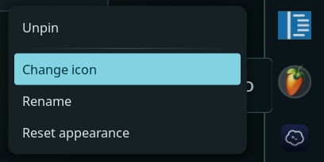

<div align="center">

# Noctalia Dock App Customizer

**Make every pinned app feel like yours.**

[🇷🇺 Русский](README.ru.md) · [🇬🇧 English](README.en.md)


*A small, focused utility for customizing application icons and names in Noctalia Dock.*

</div>

---

## Contents

- [Features](#-features)
- [Installation](#-installation-and-removal)
- [Updating](#-updating)
- [Interface language](#-interface-language)
- [How it works](#-how-it-works)
- [Tests](#-tests-and-verification)
- [Performance](#-performance-and-resource-usage)
- [Service and logs](#-service-and-logs)
- [Safety](#-safety)
- [Limitations](#️-limitations-and-compatibility)
- [Project status](#-project-status)

## ✨ Features

| Feature | Description |
|:--|:--|
| 🖼️ **Change icon** | Choose a custom image using a graphical file dialog |
| ✏️ **Rename** | Set a custom display name |
| ↩️ **Reset appearance** | Restore the original name and icon |
| ⚙️ **Automatic tracking** | Synchronize with the pinned application list |
| 🧹 **Careful cleanup** | Remove only recognized launcher copies created by this utility |
| 🌐 **Two languages** | Automatically select Russian or English |
| 🔁 **Background operation** | Run as a systemd user service |
| 📦 **Launcher refresh** | Check package launcher changes every 60 seconds while preserving custom appearance |



## 🚀 Installation and removal

The installer checks dependencies and automatically installs missing Python 3.11+ and Zenity through a supported package manager: pacman, APT, DNF, or Zypper. It requests administrator authentication through `sudo` when system packages need to be installed.

**Requirements:** Linux, Noctalia, and a running systemd user session. The installer checks for Python 3.11+ and Zenity and installs them automatically when missing.

```bash
git clone https://github.com/lkmorwwin-cmyk/noctalia-dock-app-customizer.git
cd noctalia-dock-app-customizer
bash scripts/install.sh
```

Noctalia and systemd are not installed by the script; they must already be available. If the package manager is unsupported or cannot provide Python 3.11+, the installer stops and explains what must be fixed manually.

To uninstall:

```bash
bash scripts/uninstall.sh
```

## 🔄 Updating

When a new version is released, update your source checkout and reinstall the utility's user-level files:

```bash
cd ~/noctalia-dock-app-customizer
git pull --ff-only
bash scripts/install.sh
systemctl --user restart noctalia-dock-watch.service
```

- `git pull --ff-only` fetches the update without creating a merge commit. If Git reports local changes or a conflict, do not force-reset the checkout; resolve the changes first.
- `scripts/install.sh` refreshes the installed scripts and the systemd user unit.
- Restarting the service makes the watcher run the updated code immediately.

A normal update does not remove Noctalia settings, Customizer state, or customized application names and icons. If you cloned the repository somewhere other than `~/noctalia-dock-app-customizer`, use your actual project directory.

Find new versions and release notes on [GitHub Releases](https://github.com/lkmorwwin-cmyk/noctalia-dock-app-customizer/releases) and in [CHANGELOG.md](CHANGELOG.md).

## 🌐 Interface language

Context-menu actions, dialogs, and notifications follow the desktop session locale automatically: `ru` selects Russian; all other locales use English. No extra language package or manual setting is required.

## 🧩 How it works

The utility uses standard **Desktop Actions**. It creates user-level launcher copies and adds actions that Noctalia Dock can display in its context menu.

1. Reads the pinned-app list from Noctalia settings.
2. Locates the corresponding system `.desktop` launchers, including Flatpak-exported entries through validated symlinks.
3. Creates user-level copies in `~/.local/share/applications`.
4. Adds actions for changing the icon, renaming, and resetting.
5. A background service tracks changes to the pinned-app list and checks source launchers for package updates every 60 seconds.
6. When a package updates, the managed copy receives new source fields while preserving the user's custom name, icon, and Desktop Actions.

> [!NOTE]
> This is an independent community utility — not an official Noctalia plugin and not a modification of Noctalia's source code.

## 🧪 Tests and verification

Run the checks from the repository root:

```bash
python3 -m unittest discover -s tests -v
python3 -m compileall -q src tests
bash -n scripts/install.sh
bash -n scripts/uninstall.sh
```

Security-focused tests cover, among other things:

- refusing to delete a replaced or unrecognized launcher;
- refusing to delete or follow arbitrary symlinks placed in place of a managed launcher;
- safely resolving validated Flatpak export symlinks;
- refreshing package source fields while preserving user-customized names and icons;
- accepting only validated Flatpak export symlinks that resolve inside an installed app directory;
- preserving user-level desktop-entry priority over system launchers;
- rejecting unsafe paths and malformed manifest data;
- atomic JSON writes and private file permissions;
- safe Desktop Actions cleanup.

<details>
<summary><strong>Verification snapshot — November 17, 2026</strong></summary>

- **21 of 21 tests** passed.
- Python compilation completed successfully.
- Shell syntax checks passed for both scripts.
- Installation and restart of the user service completed successfully on CachyOS.

</details>

## ⚡ Performance and resource usage

The watcher is designed for continuous background operation with a small resource footprint. It reacts immediately to Noctalia settings changes and checks pinned apps' source launchers for package updates every 60 seconds. It does not rewrite files when no source changes are detected.

**Measured snapshot on CachyOS · November 17, 2026**

| Metric | Result |
|:--|--:|
| systemd service memory | **≈ 7.8 MiB** |
| service tasks/threads | **1** |
| first cumulative CPU sample | **0.480332 s** |
| second cumulative CPU sample (20 minutes later) | **0.489231 s** |
| CPU time during the 20-minute interval | **0.008899 s (8.9 ms)** |
| average use of one logical CPU core during the interval | **≈ 0.00074%** |

The two samples were taken about 20 minutes apart: memory remained at 7.82 MiB and the task count remained at 1. The service accumulated 8.899 ms of CPU time during that interval, equivalent to approximately 0.00074% average use of one logical CPU core.

> [!IMPORTANT]
> This is a short observation on one system, not a long-duration benchmark or a guarantee for every system. The average does not rule out brief spikes. Actual usage depends on the environment, number of pinned apps, and how often settings change.

Inspect the values on your own system:

```bash
systemctl --user show noctalia-dock-watch.service \
  -p MemoryCurrent -p CPUUsageNSec -p TasksCurrent
```

## 🔍 Service and logs

```bash
# Service status
systemctl --user status noctalia-dock-watch.service

# Follow the systemd journal
journalctl --user -u noctalia-dock-watch.service -f

# Follow the utility log
tail -f ~/.local/state/noctalia-dock-watch.log
```

The watcher log rotates at 256 KiB and keeps one previous copy.

## 🛡️ Safety

- System desktop-entry files are not modified.
- Watcher-created launcher copies are recorded in a manifest.
- Unpin cleanup removes only recognized files owned by this utility.
- Replaced, unrecognized, and symlink launcher paths are preserved.
- Manifest paths and data structure are validated.
- State JSON files are written atomically with private file permissions.
- Existing user-level desktop entries are not deleted by the watcher.
- Uninstallation leaves logs and unrelated user data untouched.

## ⚠️ Limitations and compatibility

- Menu actions depend on the Dock supporting Desktop Actions.
- This is not a universal context-menu extension API.
- The Dock may take a moment to refresh after a launcher changes.
- Flatpak-exported launchers may be symlinks: the watcher accepts only links from the standard Flatpak exports directory whose targets remain inside that installation's `app` directory.
- Managed copies periodically receive updated package source fields while preserving custom names and icons saved through the Customizer. Launcher discovery and managed-copy creation were verified with Bottles (Flatpak) and Happ (AUR/yay). User-level launcher priority was verified with Termius. Actual synchronization during a real package upgrade is covered by automated tests, but has not yet been observed during an installed-app upgrade.
- If an application already has a user-level desktop entry, the utility adds actions to it. That file is not treated as a watcher-created copy and is not automatically removed.

## 🚀 Project status

**Current version: 1.1.0.** The first stable release was 1.0.0. See [GitHub Releases](https://github.com/lkmorwwin-cmyk/noctalia-dock-app-customizer/releases) for release history. Core features are implemented, the automated test suite passes, and the installer and systemd user service have been verified. See [CHANGELOG.md](CHANGELOG.md) for release notes.

## 🤝 Contributing

Bug reports and suggestions are welcome. Before opening an Issue, check existing reports and include the application installation method, launcher ID, and a relevant log excerpt with personal data removed.

See [CONTRIBUTING.md](CONTRIBUTING.md) for development guidelines and pull request expectations.

## 📄 License

Distributed under the [MIT License](LICENSE).

---

<div align="center">

**More personality. Less manual work.**

[🇷🇺 Русская документация](README.ru.md)

</div>
