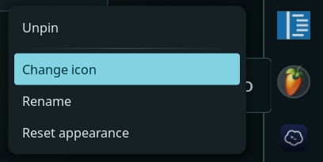

<div align="center">

# Noctalia Dock App Customizer

**Make every pinned app feel like yours.**

[🇷🇺 Русский](README.ru.md) · [🇬🇧 English](README.en.md)


*A small, focused utility for customizing application icons and names in Noctalia Dock.*

</div>

---

## At a glance

<table>
<tr>
<td align="center" width="33%">

### 🖼️ Change icon

Choose an image for a pinned app.

</td>
<td align="center" width="33%">

### ✏️ Rename

Set a custom display name.

</td>
<td align="center" width="33%">

### ↩️ Reset

Restore the original appearance.

</td>
</tr>
</table>

The utility integrates through standard Linux **Desktop Actions**. A lightweight user-level watcher keeps launcher entries synchronized with the apps pinned to the Dock and refreshes managed copies when package launchers change.



> [!NOTE]
> This is an independent community utility — not an official Noctalia plugin. It does not patch or replace Noctalia.

## Install

**Requirements:** Linux, Noctalia, and a running systemd user session. The installer automatically installs Python 3.11+ and Zenity when they are missing (supported package managers: pacman, APT, DNF, and Zypper).

```bash
git clone https://github.com/lkmorwwin-cmyk/noctalia-dock-app-customizer.git
cd noctalia-dock-app-customizer
bash scripts/install.sh
```

The installer detects the package manager, asks for administrator authentication through `sudo` when needed, installs missing runtime dependencies, verifies Python 3.11+, and then installs and starts the user service. Noctalia and systemd are not installed automatically.

To uninstall:

```bash
bash scripts/uninstall.sh
```

## Update

When a new version is released, update the existing source checkout and reinstall the user-level files:

```bash
cd ~/noctalia-dock-app-customizer
git pull --ff-only
bash scripts/install.sh
systemctl --user restart noctalia-dock-watch.service
```

The installer refreshes the installed scripts and service unit. Restarting the service makes the running watcher use the new code immediately. Your user configuration and customized launcher data are kept. If you cloned the repository into a different directory, use that directory instead of `~/noctalia-dock-app-customizer`.

Check [Releases](https://github.com/lkmorwwin-cmyk/noctalia-dock-app-customizer/releases) and [CHANGELOG](CHANGELOG.md) for new versions and their changes.

## Documentation

**Current version: 1.1.0.** See [CHANGELOG](CHANGELOG.md) for release notes.

| Language | Guide |
|:--|:--|
| 🇷🇺 Russian | [Полная документация](README.ru.md) |
| 🇬🇧 English | [Full documentation](README.en.md) |

## Project layout

| Path | Description |
|:--|:--|
| `src/noctalia_app_customize.py` | Desktop Actions and icon/name editing |
| `src/noctalia_dock_watch.py` | Pinned-app watcher and managed-file cleanup |
| `systemd/` | User service unit |
| `scripts/` | Installer and uninstaller |
| `tests/` | Automated tests |

## Verification

**21 automated tests** cover launcher editing, Flatpak export symlinks, package-source synchronization, user overrides, and safe cleanup. CI validates Python 3.11 and 3.12.

Run the test suite from the repository root:

```bash
python3 -m unittest discover -s tests -v
```

See [test documentation](tests/README.md) for the available checks and CI details.

## Resource usage

CachyOS measurements on November 17, 2026: the first two samples, 20 minutes apart, showed 7.82 MiB memory and 1 task, with 8.899 ms CPU time accumulated between them (about 0.00074% of one logical core). A further sample about an hour later showed **9.63 MiB** memory, **1 task**, and cumulative CPU time of **0.543459 s** — an increase of **54.228 ms** over that approximate one-hour interval (about **0.0015% average use of one logical CPU core**).

This is a short observation on one system, not a long-duration benchmark or a universal guarantee. The average does not rule out brief spikes; actual usage varies by system and activity. Detailed notes and a command for checking your own system are in the [Russian](README.ru.md#-производительность-и-нагрузка) and [English](README.en.md#-performance-and-resource-usage) guides.

## Service and logs

```bash
systemctl --user status noctalia-dock-watch.service
journalctl --user -u noctalia-dock-watch.service -f
tail -f ~/.local/state/noctalia-dock-watch.log
```

The watcher log rotates at 256 KiB and keeps one previous copy.

## Safety by design

- System desktop-entry files are not modified.
- Launcher copies created by the watcher are tracked in a manifest.
- Cleanup is limited to recognized launcher copies owned by this utility.
- Replaced, unrecognized, and symlink launcher paths are preserved.
- Flatpak export symlinks are accepted only when they resolve inside the matching installation's `app` directory.
- Existing user-level desktop entries are not deleted by the watcher.
- Managed launcher copies are checked for source updates every 60 seconds; custom names, icons, and Noctalia actions are retained.

---

<div align="center">

**Personalize your Dock. Keep your system files untouched.**

MIT License · Contributions welcome

</div>
