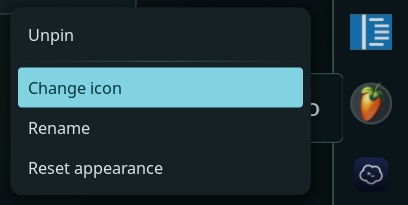

<div align="center">

# Noctalia Dock App Customizer

**Сделай каждое закреплённое приложение своим.**

[🇷🇺 Русский](README.ru.md) · [🇬🇧 English](README.en.md)


*Небольшая утилита для настройки иконок и имён приложений в Noctalia Dock.*

</div>

---

## Содержание

- [Возможности](#-возможности)
- [Установка и удаление](#-установка-и-удаление)
- [Обновление](#-обновление)
- [Язык интерфейса](#-язык-интерфейса)
- [Как это работает](#-как-это-работает)
- [Тесты и проверка](#-тесты-и-проверка)
- [Производительность](#-производительность-и-нагрузка)
- [Управление службой](#-управление-службой)
- [Безопасность](#-безопасность)
- [Ограничения](#️-ограничения-и-совместимость)
- [Статус проекта](#-статус-проекта)

## ✨ Возможности

| Функция | Что делает |
|:--|:--|
| 🖼️ **Смена иконки** | Выбор собственного изображения через графический диалог |
| ✏️ **Переименование** | Установка пользовательского отображаемого имени |
| ↩️ **Сброс оформления** | Восстановление исходных имени и значка |
| ⚙️ **Автоотслеживание** | Синхронизация со списком закреплённых приложений |
| 🧹 **Безопасная очистка** | Удаление только распознанных копий, созданных утилитой |
| 🌐 **Два языка** | Автоматический выбор русского или английского |
| 🔁 **Фоновая работа** | Запуск в пользовательской службе systemd |
| 📦 **Обновление launcher** | Проверка изменений исходных ярлыков пакетов каждые 60 секунд с сохранением пользовательского оформления |



## 🚀 Установка и удаление

Установочный скрипт проверяет зависимости и автоматически устанавливает отсутствующие Python 3.11+ и Zenity через поддерживаемый пакетный менеджер: pacman, APT, DNF или Zypper. Для установки системных пакетов потребуется подтверждение через `sudo`.

**Требования:** Linux, Noctalia и запущенная пользовательская сессия systemd. Python 3.11+ и Zenity установщик проверяет и при необходимости устанавливает автоматически.

```bash
git clone https://github.com/lkmorwwin-cmyk/noctalia-dock-app-customizer.git
cd noctalia-dock-app-customizer
bash scripts/install.sh
```

Установщик не устанавливает Noctalia и systemd: они должны уже присутствовать в системе. Если пакетный менеджер не поддерживается или не может предоставить Python 3.11+, установщик остановится и покажет, что нужно исправить вручную.

Удаление:

```bash
bash scripts/uninstall.sh
```

## 🔄 Обновление

Когда выходит новая версия, обновите исходный репозиторий и переустановите файлы утилиты:

```bash
cd ~/noctalia-dock-app-customizer
git pull --ff-only
bash scripts/install.sh
systemctl --user restart noctalia-dock-watch.service
```

- `git pull --ff-only` загружает обновления без создания merge-коммита. Если Git сообщит о локальных изменениях или конфликте, не используйте принудительный сброс — сначала разберитесь с этими изменениями.
- `scripts/install.sh` обновляет установленные скрипты и пользовательский unit-файл systemd.
- Перезапуск службы запускает watcher уже с новым кодом.

Пользовательские настройки Noctalia, состояние Customizer и пользовательские иконки/имена приложений при штатном обновлении не удаляются. Если репозиторий был клонирован не в `~/noctalia-dock-app-customizer`, перейдите в фактический каталог проекта.

Новые версии и список изменений: [GitHub Releases](https://github.com/lkmorwwin-cmyk/noctalia-dock-app-customizer/releases) и [CHANGELOG.md](CHANGELOG.md).

## 🌐 Язык интерфейса

Язык пунктов контекстного меню, диалогов и уведомлений выбирается автоматически по локали рабочего стола: `ru` включает русский, остальные языки — английский. Дополнительные языковые пакеты и ручное переключение не нужны.

## 🧩 Как это работает

Утилита использует стандартный механизм **Desktop Actions**. Она создаёт пользовательские копии launcher-файлов и добавляет действия, которые Noctalia Dock может показывать в контекстном меню.

<ol>
<li>Читает список закреплённых приложений из настроек Noctalia.</li>
<li>Находит соответствующие системные файлы <code>.desktop</code>.</li>
<li>Создаёт пользовательские копии в <code>~/.local/share/applications</code>.</li>
<li>Добавляет действия смены иконки, переименования и сброса.</li>
<li>Фоновая служба отслеживает изменения списка закреплённых приложений и раз в 60 секунд проверяет исходные launcher-файлы на обновления.</li>
<li>При обновлении пакета управляемая копия получает новые исходные параметры, сохраняя пользовательские имя, иконку и Desktop Actions.</li>
</ol>

> [!NOTE]
> Это самостоятельная community-утилита, а не официальный плагин Noctalia и не модификация его исходного кода.

## 🧪 Тесты и проверка

Запуск из корня репозитория:

```bash
python3 -m unittest discover -s tests -v
python3 -m compileall -q src tests
bash -n scripts/install.sh
bash -n scripts/uninstall.sh
```

Тесты безопасности, помимо прочего, проверяют:

- отказ от удаления заменённого или неизвестного launcher-файла;
- отказ от удаления и разыменования произвольных символических ссылок на месте управляемого launcher;
- безопасную обработку Flatpak export-ссылок;
- синхронизацию исходных параметров после обновления пакета с сохранением пользовательских имени и иконки;
- разрешение только проверенных Flatpak export-ссылок, ведущих внутрь каталога приложения;
- приоритет пользовательского desktop-файла над системным ярлыком;
- отклонение небезопасных путей и некорректных данных manifest;
- атомарную запись JSON и приватные права доступа;
- безопасную очистку Desktop Actions.

<details>
<summary><strong>Результат контрольной проверки — 17 ноября 2026 года</strong></summary>

- **21 из 21 теста** прошли успешно.
- Компиляция Python завершилась без ошибок.
- Синтаксис обоих shell-скриптов проверен успешно.
- Установка и перезапуск пользовательской службы на CachyOS прошли без ошибок.

</details>

## ⚡ Производительность и нагрузка

Watcher рассчитан на постоянную фоновую работу с небольшим потреблением ресурсов. Он немедленно реагирует на изменения настроек Noctalia и раз в 60 секунд проверяет исходные launcher-файлы закреплённых приложений на обновления. Файлы не перезаписываются без необходимости.

**Измеренный снимок на CachyOS · 17 ноября 2026 года**

| Показатель | Значение |
|:--|--:|
| Память службы systemd | **≈ 7,8 МиБ** |
| Задачи/потоки службы | **1** |
| CPU-время, первый снимок | **0,480332 с** |
| CPU-время, второй снимок (через 20 минут) | **0,489231 с** |
| CPU за 20-минутный интервал | **0,008899 с (8,9 мс)** |
| Средняя загрузка одного логического ядра за интервал | **≈ 0,00074%** |

Два снимка разделены примерно 20 минутами: память осталась на уровне 7,82 МиБ, число задач — 1. За интервал служба накопила 8,899 мс CPU-времени, что соответствует средней загрузке одного логического ядра около 0,00074%.

> [!IMPORTANT]
> Это короткое наблюдение на одной системе, а не длительный бенчмарк и не гарантия одинаковой нагрузки на всех системах. Среднее значение не исключает кратковременных всплесков. Результаты зависят от окружения, числа закреплённых приложений и частоты изменений настроек.

Проверить показатели на своей системе:

```bash
systemctl --user show noctalia-dock-watch.service \
  -p MemoryCurrent -p CPUUsageNSec -p TasksCurrent
```

## 🔍 Управление службой и журналы

```bash
# Состояние службы
systemctl --user status noctalia-dock-watch.service

# Журнал systemd в реальном времени
journalctl --user -u noctalia-dock-watch.service -f

# Журнал самой утилиты
tail -f ~/.local/state/noctalia-dock-watch.log
```

Размер журнала ограничен 256 КиБ; сохраняется одна предыдущая копия.

## 🛡️ Безопасность

- Системные desktop-файлы не изменяются.
- Созданные watcher копии записываются в manifest.
- При откреплении удаляются только распознанные файлы, принадлежащие утилите.
- Заменённые, неизвестные файлы и символические ссылки вместо управляемых launcher сохраняются.
- Manifest проверяется на небезопасные пути и некорректную структуру данных.
- JSON-файлы состояния записываются атомарно с приватными правами доступа.
- Существующие пользовательские desktop-файлы watcher не удаляет.
- Удаление утилиты не затрагивает журналы и посторонние пользовательские данные.

## ⚠️ Ограничения и совместимость

- Пункты меню зависят от поддержки Desktop Actions со стороны Dock.
- Это не универсальный API расширения контекстного меню.
- После изменения launcher-файла Dock может обновить меню с небольшой задержкой.
- Экспортированные Flatpak-ярлыки могут быть символическими ссылками: watcher принимает только ссылки из стандартного каталога Flatpak exports, цель которых находится внутри каталога `app` соответствующей установки.
- Для управляемых копий периодически синхронизируются исходные поля после обновления пакета; пользовательские имя и иконка, сохранённые через Customizer, остаются без изменений. Обнаружение и создание управляемых копий проверено на Bottles (Flatpak) и Happ (AUR/yay). Для Termius проверен приоритет уже существующего пользовательского launcher. Само обновление пакета в реальном времени пока покрыто автоматическими тестами, а не проверкой фактического обновления установленного приложения.
- Если у приложения уже есть пользовательский desktop-файл, утилита добавляет действия в него. Такой файл не считается копией, созданной watcher, и автоматически не удаляется.

## 🚀 Статус проекта

**Текущая версия: 1.1.0.** Первый стабильный релиз — 1.0.0. История выпусков: [GitHub Releases](https://github.com/lkmorwwin-cmyk/noctalia-dock-app-customizer/releases). Основные функции реализованы, автоматические тесты проходят, а установщик и пользовательская systemd-служба проверены. История изменений: [CHANGELOG.md](CHANGELOG.md).

## 🤝 Участие в проекте

Баг-репорты и предложения приветствуются. Перед созданием Issue проверьте существующие обращения. Укажите способ установки приложения, ID launcher-файла и относящийся к проблеме фрагмент журнала без личных данных.

Правила для изменений и pull request описаны в [CONTRIBUTING.md](CONTRIBUTING.md).

## 📄 Лицензия

Проект распространяется по лицензии [MIT](LICENSE).

---

<div align="center">

**Больше индивидуальности. Меньше ручной работы.**

[🇬🇧 English documentation](README.en.md)

</div>
